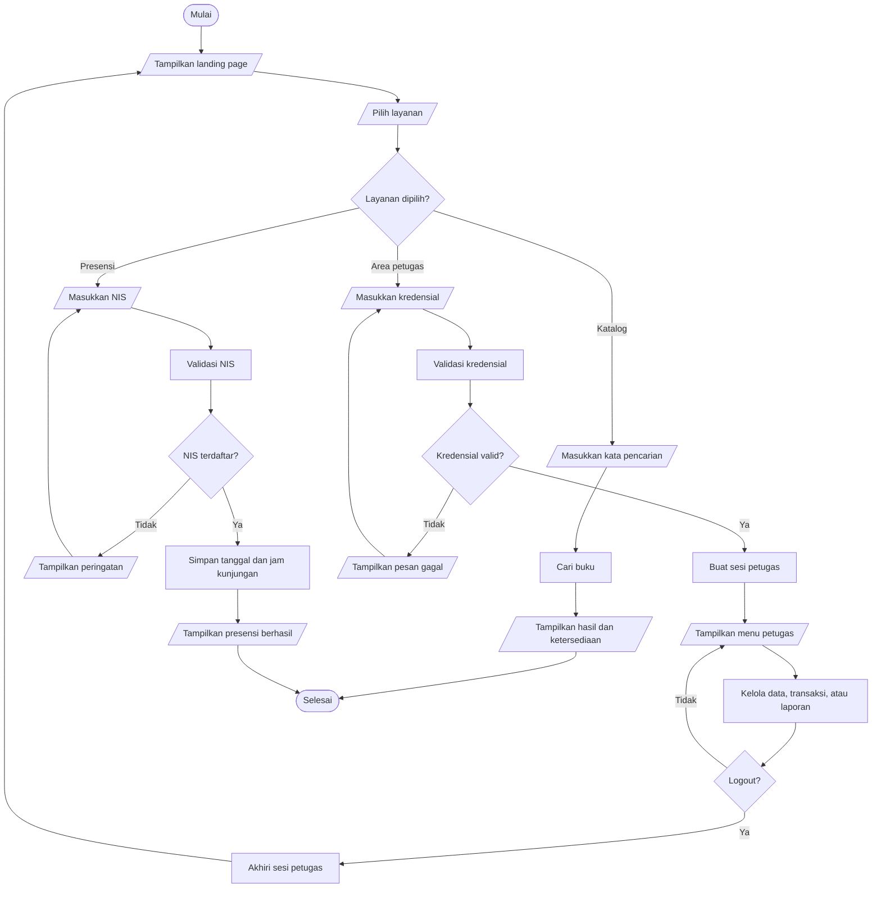
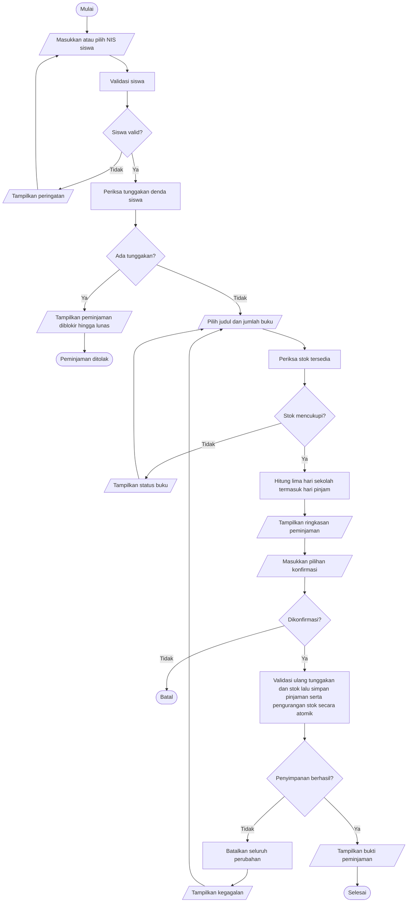
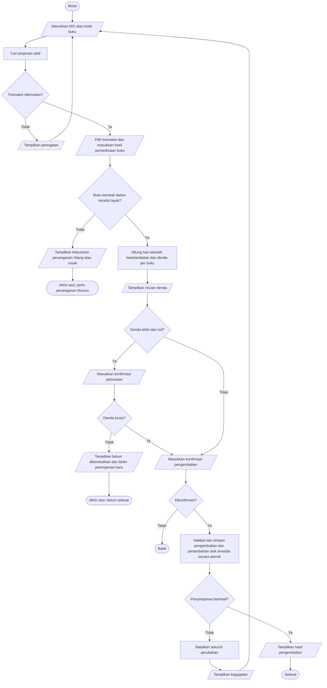
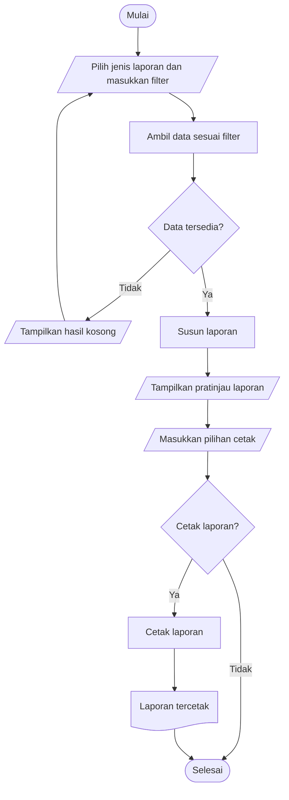
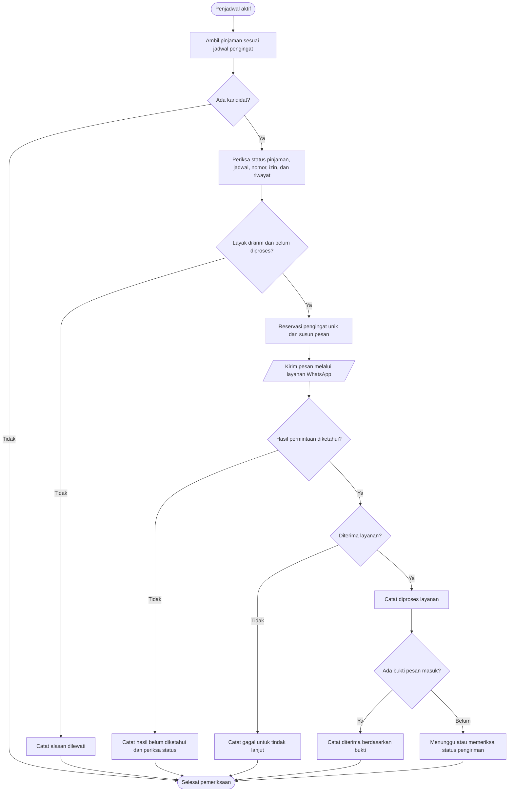

# PRD — SIPUS Digital

Versi: 0.5 — Draft diskusi  
Tanggal: 6 November 2026  
Mitra: Perpustakaan SMK Mutiara Ilmu

## 1. Dasar dan status keputusan

Sumber: proposal PROJECT BASED LEARNING WEB.pdf, khususnya kebutuhan dan UML pada halaman bernomor 6–14, serta klarifikasi Ali pada 6 November 2026.

- **Dikonfirmasi:** project baru memiliki UML; implementasi kode dibangun dari awal.
- **Dikonfirmasi:** siswa tidak memiliki akun. Siswa mengakses katalog dan melakukan presensi dengan NIS.
- **Dikonfirmasi:** output web wajib memiliki landing page. Flowchart dibutuhkan sebagai output perkuliahan hari ini.
- **Dari proposal:** petugas login, mengelola buku/anggota, memproses pinjam/kembali, menghitung denda, dan mencetak laporan.
- **Dikonfirmasi:** masa pinjam lima hari sekolah, Senin–Jumat. Denda Rp2.000 per hari keterlambatan juga hanya dihitung pada hari sekolah.
- **Dikonfirmasi:** denda wajib dilunasi sebelum transaksi pengembalian diselesaikan.
- **Dikonfirmasi:** buku dikelola berdasarkan stok per judul, tanpa kewajiban kode unik setiap eksemplar. Setiap detail pinjaman tetap mencatat identitas buku dan jumlahnya.
- **Dikonfirmasi:** hari peminjaman dihitung sebagai hari ke-1. Sabtu, Minggu, dan tanggal merah tidak dihitung untuk masa pinjam maupun denda.
- **Dikonfirmasi:** tarif Rp2.000 per buku per hari sekolah keterlambatan. Setiap tambahan satu hari sekolah keterlambatan menambah Rp2.000 untuk setiap buku yang dikenai denda.
- **Dikonfirmasi:** buku boleh diterima secara fisik, tetapi di sistem tetap belum dikembalikan sebelum denda lunas. Selama ada tunggakan, siswa tidak boleh melakukan peminjaman baru.
- **Dikonfirmasi:** data siswa diminta dari mitra; pengujian ke dosen boleh menggunakan data dummy.
- **Dikonfirmasi:** target PJBL berjalan lokal. Penyerahan ke mitra dan hosting produksi dibahas terpisah.
- **Dikonfirmasi:** sistem mengirim pengingat WhatsApp otomatis sebelum masa pinjam habis; nomor WhatsApp peminjam ditambahkan pada data siswa.
- **Dikonfirmasi:** demo wajib membuktikan pesan benar-benar masuk ke WhatsApp penerima. Simulasi dan respons API saja tidak memenuhi syarat.
- **Usulan:** pengingat H-1 hari sekolah pukul 09.00 WITA; jadwal masih perlu diputuskan. Nomor penerima demo memakai nomor anggota kelompok yang menyetujui pengiriman.
- **Belum diputuskan:** penghentian/kelanjutan denda setelah buku diterima fisik tetapi belum lunas; batas jumlah buku; pengembalian sebagian; batas jam; libur sekolah selain tanggal merah; dan kebijakan hilang/rusak. Presensi diawasi petugas masih merupakan usulan.

Dokumen ini belum menjadi spesifikasi final. Usulan dan keputusan terbuka tidak boleh diterapkan sebagai kebijakan final tanpa pembahasan.

## 2. Masalah dan tujuan produk

Pencatatan melalui buku besar menyebabkan identitas peminjam tidak lengkap, pencarian riwayat lambat, perhitungan denda rawan salah, serta rekap laporan berulang.

SIPUS Digital membantu petugas mencatat transaksi secara konsisten, melacak ketersediaan buku, menghitung jatuh tempo/denda, dan menyusun laporan. Siswa dapat mengenali layanan perpustakaan, mencari buku, dan mencatat kunjungan tanpa membuat akun.

Keberhasilan awal diukur melalui demonstrasi alur lengkap: landing page → katalog/presensi; login petugas → peminjaman → pengingat otomatis benar-benar diterima di WhatsApp → pengembalian → laporan. Klaim penghematan waktu memerlukan pengukuran sebelum dan sesudah implementasi.

## 3. Pengguna dan hak akses

| Pengguna | Hak akses |
|---|---|
| Pengunjung/siswa tanpa akun | Landing page, katalog, detail ketersediaan, presensi melalui NIS |
| Petugas terautentikasi | Data siswa dan WhatsApp, buku dan stok, transaksi, riwayat, denda, laporan, pemantauan pengingat |
| Kepala sekolah/yayasan | Menerima laporan dari petugas; akun khusus tidak termasuk lingkup awal |

Riwayat dan denda per siswa diakses melalui petugas pada draft ini. Proposal sebelumnya menyebut siswa dapat melihat riwayat sendiri; mekanisme akses tersebut perlu direvisi karena tidak ada akun siswa. Jangan membuka riwayat pribadi kepada publik hanya dengan mengetahui NIS.

## 4. Lingkup MVP dan kebutuhan penerimaan

| ID | Kebutuhan | Kriteria penerimaan awal |
|---|---|---|
| FR-01 | Landing page | Identitas perpustakaan, informasi layanan, aturan pinjam, tautan katalog, presensi, dan login petugas tersedia. Informasi yang belum diberikan mitra tidak boleh dikarang. |
| FR-02 | Katalog publik | Siswa mencari judul dan melihat detail serta ketersediaan tanpa login; kondisi hasil kosong ditangani. Metadata/filter tambahan ditentukan saat desain. |
| FR-03 | Presensi NIS | NIS terdaftar mencatat waktu kunjungan; NIS tidak dikenal tidak membuat kunjungan dan menampilkan arahan ke petugas. Nama bukan pengganti NIS pada alur yang dikonfirmasi. |
| FR-04 | Login petugas | Kredensial valid membuka area petugas; akses langsung tanpa sesi ditolak; logout mengakhiri sesi. |
| FR-05 | Kelola siswa | Petugas menambah/memperbarui NIS, nama, kelas, dan nomor WhatsApp peminjam; NIS unik; data yang terkait transaksi tetap dapat ditelusuri ketika siswa dinonaktifkan. Penonaktifan merupakan usulan pengganti penghapusan permanen. |
| FR-06 | Kelola buku | Petugas mengelola katalog dan jumlah stok per judul: total, tersedia, sedang dipinjam, dan hilang sesuai kebutuhan. Jumlah dipinjam tidak boleh melebihi stok tersedia; satu judul dapat tersedia sekaligus memiliki sejumlah buku yang dipinjam. |
| FR-07 | Peminjaman | Siswa valid tanpa tunggakan denda dan jumlah buku tidak melebihi stok tersedia menghasilkan transaksi aktif serta jatuh tempo lima hari sekolah. Hari pinjam dihitung sebagai hari ke-1; Sabtu/Minggu/tanggal merah dilewati. Simpan transaksi dan pengurangan stok bersama; tolak peminjaman jika syarat tidak terpenuhi. |
| FR-08 | Pengembalian | Petugas memilih detail pinjaman yang tepat. Buku boleh diterima fisik, tetapi sistem tetap mencatat belum dikembalikan jika denda belum lunas. Pengembalian sistem dan penambahan stok tersedia dilakukan setelah pelunasan/konfirmasi pengembalian; perubahan stok tidak boleh diterapkan dua kali. Catatan penerimaan fisik terpisah merupakan usulan. |
| FR-09 | Denda | Tarif Rp2.000 per buku per hari sekolah keterlambatan; setiap tambahan satu hari sekolah menambah Rp2.000 per buku. Sabtu, Minggu, dan tanggal merah tidak menambah denda. Petugas melihat rincian tanggal dan perhitungan; pengembalian tepat waktu menghasilkan Rp0. Jika ada denda, transaksi pengembalian hanya selesai setelah pelunasan dikonfirmasi. |
| FR-10 | Riwayat dan pencarian | Petugas dapat mencari siswa dan memilih transaksi/detail buku secara jelas bila hasil lebih dari satu; riwayat tetap tersedia setelah pengembalian. |
| FR-11 | Laporan | Petugas menyaring dan mencetak laporan buku, peminjaman, serta kunjungan; judul, periode bila relevan, waktu cetak, dan hasil kosong ditampilkan dengan jelas. |
| FR-12 | Nomor WhatsApp | Petugas mencatat nomor tujuan, memvalidasi format, dan memastikan tujuan pengingat yang disepakati peminjam. NIS tetap identitas siswa. Nomor tidak muncul pada katalog publik. |
| FR-13 | Pengingat otomatis | Penjadwal memilih pinjaman aktif yang mendekati jatuh tempo dan mengirim pengingat WhatsApp tanpa klik kirim per pesan. Jadwal H-1 hari sekolah pukul 09.00 WITA masih usulan. |
| FR-14 | Riwayat pengiriman | Petugas melihat nomor tujuan, pinjaman terkait, waktu, isi/ringkasan, status, dan alasan gagal bila tersedia. Bedakan diproses layanan, diterima di WhatsApp, gagal, dan hasil belum diketahui. |
| FR-15 | Keandalan pengingat | Cegah kirim ulang pengingat yang sama saat penjadwal dijalankan lagi; tangani nomor tidak valid dan koneksi gagal tanpa merusak pinjaman. Jangan menganggap respons API berhasil sebagai bukti pesan masuk. |

Di luar MVP: akun siswa, peminjaman mandiri/reservasi online, payment gateway, barcode/QR scanner, aplikasi mobile native, dan akun pimpinan. Fitur tersebut belum diminta dan hanya masuk jika lingkup berubah.

## 5. Aturan bisnis dan keputusan terbuka

| ID | Topik | Status dan konsekuensi |
|---|---|---|
| BR-01 | Lima hari peminjaman | Hari pinjam dihitung sebagai hari ke-1, jika merupakan hari sekolah. Hari sekolah Senin–Jumat, kecuali tanggal merah. Sabtu/Minggu/tanggal merah dilewati. Batas jam dan libur semester selain tanggal merah belum ditentukan. |
| BR-02 | Denda | Rp2.000 per buku per hari sekolah keterlambatan. Setiap satu hari sekolah terlambat menambah Rp2.000 per buku. Tidak dihitung pada Sabtu/Minggu/tanggal merah. |
| BR-03 | Stok buku | Kelola stok per judul; transaksi mencatat buku dan jumlah. Tidak mewajibkan identitas unik setiap buku fisik. Jumlah pinjam harus positif dan tidak melebihi stok tersedia. Pinjam mengurangi stok tersedia; pengembalian sistem menambahnya setelah selesai. |
| BR-04 | Data siswa | Gunakan data mitra bila tersedia. Data dummy boleh untuk pengujian ke dosen dan diberi label simulasi. NIS harus unik dan terdaftar. |
| BR-05 | Buku kembali, denda belum lunas | Buku tetap diterima secara fisik, tetapi status di sistem belum dikembalikan. Siswa diblokir dari pinjaman baru hingga seluruh tunggakan lunas. Detail penerimaan fisik dan apakah denda terus berjalan sesudah penerimaan masih perlu penegasan. |
| BR-06 | Presensi | Usulan untuk lokal: satu terminal di meja petugas, input NIS lalu tampilkan nama/kelas agar petugas dapat mengawasi. Bukan autentikasi akun siswa. Persetujuan usulan dan aturan kunjungan berulang masih terbuka. |
| BR-07 | Batas pinjaman | Jumlah maksimum, perpanjangan, serta pengembalian/pelunasan sebagian belum ditentukan. Blokir peminjam yang memiliki tunggakan sudah dikonfirmasi. |
| BR-08 | Hilang/rusak | Penanganan, ganti rugi, dan pembaruan stok hilang/rusak perlu aturan lanjutan. Jangan otomatis menambah stok tersedia. |
| BR-09 | Kalender | Tanggal merah harus tersedia pada kalender sistem lokal agar dapat dikecualikan. Usulan: daftar tanggal libur yang dikelola petugas, tanpa ketergantungan API eksternal. Zona waktu usulan Asia/Makassar; cakupan libur sekolah lain belum ditentukan. |
| BR-10 | Operasional | Aplikasi dan database PJBL berjalan lokal tanpa hosting publik. Pengiriman WA nyata memerlukan internet serta komputer dan penjadwal aktif. Hosting/serah terima mitra merupakan lingkup lanjutan. |
| BR-11 | Pengingat WhatsApp | Wajib otomatis dan benar-benar diterima pada demo. Usulan H-1 hari sekolah pukul 09.00 WITA; hari libur dilewati ke hari sekolah sebelumnya. Penyedia WA, nomor pengirim, dan biaya belum dipilih. |
| BR-12 | Data kontak | NIS tetap identitas; nomor WhatsApp merupakan alamat pengingat. Catat persetujuan menerima pengingat, kepemilikan nomor, dan validitas format. Apakah nomor wajib saat pinjam serta alternatif siswa tanpa WA masih terbuka. |

Rumus: hari terlambat = jumlah hari sekolah setelah jatuh tempo sampai tanggal perhitungan. Denda detail buku = hari terlambat × Rp2.000 × jumlah buku pada detail tersebut yang dikenai denda. Total denda adalah penjumlahan rincian; jika tanggal jatuh tempo berbeda, hitung setiap detail secara terpisah. Tanggal berhenti menghitung setelah penerimaan fisik sebelum pelunasan belum diputuskan.

Contoh, tanpa tanggal merah tambahan: pinjam Jumat, 6 November 2026 sebagai hari ke-1 → Senin 9 November hari ke-2 → Kamis 12 November hari ke-5/jatuh tempo. Kembali Jumat 13 November: satu hari terlambat; satu buku Rp2.000, dua buku dengan jatuh tempo sama Rp4.000. Kembali Senin 16 November: dua hari sekolah terlambat; satu buku Rp4.000, dua buku Rp8.000. Sabtu/Minggu tidak menambah denda. Contoh mengasumsikan penyerahan dan pelunasan dilakukan pada hari yang sama.

**Penegasan untuk antarmuka:** “Denda Rp2.000 per buku untuk setiap tambahan satu hari sekolah keterlambatan. Sabtu, Minggu, dan tanggal merah tidak dihitung. Siswa yang memiliki tunggakan belum dapat meminjam buku lagi.”

## 6. Kebutuhan kualitas

- Antarmuka responsif pada komputer operasional dan ponsel; target perangkat/ukuran layar disepakati saat desain.
- Proposal menargetkan pencarian dan transaksi kurang dari dua detik. Jumlah data, pengguna bersamaan, jaringan, perangkat, dan metode pengukuran belum ditentukan; target belum dapat dinyatakan terpenuhi.
- Hak akses petugas divalidasi pada server, bukan hanya menyembunyikan tombol.
- Input divalidasi; kredensial disimpan dengan hashing yang sesuai; data pribadi/riwayat siswa tidak muncul di katalog publik.
- Pencatatan pinjaman dan pengurangan stok harus berhasil atau gagal bersama. Permintaan bersamaan tidak boleh membuat stok negatif; pengembalian tidak boleh menambah stok dua kali.
- Usulan: simpan identitas petugas dan waktu transaksi untuk penelusuran koreksi; pembatalan/koreksi transaksi perlu aturan tersendiri.
- Data historis tidak dihapus lewat penghapusan master secara tidak sengaja. Backup dan pemulihan dibahas dalam architecture.
- Kegagalan layanan WA tidak boleh membatalkan transaksi pinjaman yang sudah sah. Jangan tampilkan nomor kontak atau kredensial pengiriman di halaman publik.
- Penjadwal dan koneksi wajib aktif untuk pengiriman. Jika komputer mati, pekerjaan tidak berjalan. Saat aktif kembali, evaluasi pengingat terlewat dan catat hasilnya; jangan mengirim pesan sebelum-jatuh-tempo yang sudah kedaluwarsa.

## 7. Struktur halaman awal

**Publik:** landing page, katalog, detail buku, presensi NIS, login petugas.

**Petugas:** ringkasan operasional (usulan), data siswa, buku dan stok, peminjaman, pengembalian, riwayat/denda, laporan, serta riwayat pengiriman WhatsApp.

Ringkasan operasional bukan perluasan fitur analitik; tujuannya membantu navigasi dan melihat pinjaman aktif. Susunan final disusun pada tahap design.

### 7.1 Rancangan pengingat WhatsApp

**Status:** fitur dan bukti pengiriman nyata sudah disepakati; jadwal serta pilihan layanan belum diputuskan. Tidak ada pesan yang dikirim sebagai bagian dari revisi dokumen ini.

- Penjadwal berjalan di sisi layanan lokal, terpisah dari kebutuhan halaman browser tetap terbuka. Komputer/server dan internet harus aktif.
- Usulan jadwal: H-1 hari sekolah pukul 09.00 WITA. Jika jatuh tempo Senin, pengingat dijadwalkan Jumat sebelumnya jika bukan tanggal merah. Gunakan kalender yang sama dengan perhitungan jatuh tempo.
- Pilih pinjaman yang masih aktif dan belum melewati jatuh tempo. Periksa kembali status pinjaman, jadwal, nomor tujuan, persetujuan, serta pengingat sebelumnya tepat sebelum kirim.
- Pesan berisi identitas perpustakaan, nama siswa, judul/jumlah buku, tanggal jatuh tempo, dan penegasan denda Rp2.000 per buku per hari sekolah keterlambatan.
- NIS digunakan untuk relasi data; nomor WhatsApp tidak menjadi identitas unik siswa karena nomor dapat berubah atau dipakai bersama.
- Catat setidaknya: siswa, pinjaman/detail terkait, jenis/jadwal pengingat, nomor tujuan saat kirim, isi pesan, waktu percobaan, status, identitas pesan dari penyedia jika tersedia, dan kesalahan.
- Gunakan identitas pengingat yang tetap, misalnya pinjaman + jenis pengingat + jatuh tempo, agar pemeriksaan ulang tidak membuat pesan baru untuk pengingat yang sama. Pemrosesan bersamaan harus dicegah.
- Bedakan status antre, diproses layanan, diterima, gagal, hasil belum diketahui, dan dilewati sesuai kebutuhan. Status diterima hanya berdasarkan bukti yang sah, bukan sekadar HTTP sukses. Metode penerimaan status/webhook mengikuti layanan terpilih dan akses lokal.
- Percobaan ulang hanya untuk kegagalan yang jelas sesuai aturan layanan. Jika hasil kirim belum diketahui, periksa status dahulu; jangan otomatis mengirim ulang karena dapat menyebabkan pesan ganda.
- Jika penjadwal terlewat saat komputer mati, usulan: kirim susulan hanya bila pinjaman masih relevan dan belum melewati jatuh tempo; bila sudah kedaluwarsa, catat dilewati. Pengingat keterlambatan/denda rutin belum masuk lingkup.
- Pengiriman nyata harus diuji lebih awal sebelum implementasi penuh: satu pesan dari aplikasi lokal terlihat masuk di HP penerima. Pilihan penyedia, nomor pengirim, template, biaya, dan metode pemantauan status diputuskan pada architecture.

**Data siswa yang perlu disiapkan:** NIS, nama, kelas, nomor WhatsApp, keterangan pemilik nomor, serta bukti/waktu persetujuan menerima pengingat. Detail kolom dan kewajiban isian diputuskan pada database/design. Data dummy tidak boleh memakai nomor acak; gunakan nomor penguji yang menyetujui pesan.

**Skenario demo:** siapkan pinjaman uji dan jadwal uji yang terdokumentasi; jalankan penjadwal otomatis; tunjukkan pesan masuk pada WhatsApp anggota kelompok; cocokkan judul dan jatuh tempo; jalankan pemeriksaan ulang untuk memastikan tidak terjadi duplikasi. Jadwal uji boleh dipercepat secara eksplisit tanpa mengubah jam sistem atau menyatakan jadwal usulan sebagai keputusan final.

**Keputusan terbuka khusus WA:** penyedia/jalur integrasi, akun/nomor pengirim, anggaran, jadwal final, nomor wajib atau opsional untuk peminjaman, serta kebijakan siswa tanpa WhatsApp. Simulasi tetap boleh untuk pengujian internal tetapi bukan pengganti demo kirim nyata.

## 8. Flowchart

Flowchart di bawah menggambarkan rancangan aplikasi, bukan sistem yang sudah terimplementasi. Pelunasan denda menjadi syarat penyelesaian pengembalian; buku diterima fisik namun tetap belum dikembalikan di sistem jika denda belum lunas. Kelanjutan perhitungan denda setelah penerimaan tersebut masih terbuka.

### Konvensi simbol

| Bentuk | Fungsi | Notasi Mermaid |
|---|---|---|
| Terminator membulat | Awal/akhir alur, termasuk akhir sesi yang belum menyelesaikan transaksi | `A([Mulai])` |
| Persegi panjang | Proses atau tindakan | `A[Validasi NIS]` |
| Belah ketupat | Keputusan; setiap panah keluar diberi label | `A{NIS valid?}` |
| Jajar genjang | Input pengguna atau output layar | `A[/Masukkan NIS/]` |
| Silinder | Penyimpanan data, bila ditampilkan sebagai objek data | `A[(Database)]` |
| Dokumen dengan bawah bergelombang | Dokumen hasil cetak | `A@{ shape: doc, label: "Laporan tercetak" }` |

Flowchart ini berfokus pada urutan proses. Membaca/menyimpan data digambar sebagai proses; silinder hanya digunakan ketika penyimpanan datanya sendiri perlu diperlihatkan. Tidak perlu menyisipkan silinder pada setiap akses data. Simbol dokumen pada bagian laporan memerlukan renderer Mermaid yang mendukung expanded node shapes.

### 8.1 Akses utama

Alur katalog di sini diringkas sebagai satu layanan; pencarian rinci dijabarkan pada tahap design.

### 8.2 Peminjaman oleh petugas

Prasyarat: petugas telah login. Pilih identitas judul dan jumlah buku; periksa seluruh tunggakan siswa sebelum peminjaman baru. Hari pinjam adalah hari ke-1; tanggal merah dikecualikan.

### 8.3 Pengembalian dan denda

Prasyarat: petugas telah login. Pembayaran wajib lunas sebelum transaksi selesai. Terminator “Akhir sesi: belum selesai” berarti sesi layanan berhenti, bukan pinjaman dinyatakan selesai. Jika buku sudah diterima fisik dan denda belum lunas, status sistem tetap belum dikembalikan dan siswa diblokir dari pinjaman baru. Kelanjutan denda setelah penerimaan fisik serta penanganan hilang/rusak masih terbuka.

### 8.4 Laporan oleh petugas

Prasyarat: petugas telah login. Proses mencetak dan dokumen yang dihasilkan digambar sebagai dua hal berbeda.

### 8.5 Pengingat WhatsApp otomatis

Pemicu penjadwal, bukan klik kirim petugas. Jadwal mengikuti konfigurasi yang akan disepakati. Alur ini adalah rancangan, bukan klaim integrasi telah bekerja.

Penjadwal memproses setiap kandidat dan mengakhiri pemeriksaan setelah seluruhnya dievaluasi; diagram menunjukkan satu kandidat untuk menjaga keterbacaan. Pengiriman ulang tidak boleh dilakukan buta ketika hasilnya belum diketahui.

## 9. Koreksi UML yang diperlukan

1. Activity diagram presensi pada halaman bernomor 10 ternyata menggambarkan login petugas; ganti dengan validasi NIS dan pencatatan kunjungan.
2. Subjudul diagram pengembalian pada halaman 12 masih tertulis peminjaman; perbaiki.
3. Selaraskan use case riwayat siswa dengan keputusan tanpa akun; pada draft ini riwayat dilayani petugas.
4. Selaraskan buku dengan pengelolaan stok per judul; transaksi mengidentifikasi buku dan jumlah yang dipinjam, bukan kode wajib per eksemplar.
5. Tambahkan penolakan peminjaman karena tunggakan, stok tidak mencukupi, serta status belum dikembalikan sebelum pelunasan. Pertahankan kelanjutan denda setelah penerimaan fisik sebagai pertanyaan terbuka.

6. Tambahkan proses otomatis pengingat WhatsApp, data nomor siswa, serta pemantauan pengiriman pada UML. Sistem/penjadwal memicu proses; layanan WA merupakan integrasi eksternal.

## 10. Skenario penerimaan utama

1. Siswa membuka landing page dan katalog tanpa login.
2. NIS terdaftar menghasilkan presensi; NIS tidak dikenal tidak membuat data kunjungan.
3. Pengunjung tanpa sesi tidak dapat mengubah master atau memproses transaksi.
4. Siswa tanpa tunggakan boleh meminjam jika jumlah buku tidak melebihi stok tersedia. Penyimpanan gagal tidak mengurangi stok.
5. Hari pinjam dihitung sebagai hari ke-1; Sabtu/Minggu/tanggal merah dilewati. Satu hari sekolah tambahan terlambat menambah Rp2.000 per buku.
6. Dua buku dengan keterlambatan satu hari sekolah menghasilkan denda Rp4.000; rincian beda jatuh tempo dihitung terpisah.
7. Buku yang sudah diterima fisik tetapi belum lunas tetap belum dikembalikan di sistem; peminjaman baru siswa tersebut ditolak.
8. Setelah seluruh tunggakan lunas, blokir denda tidak lagi berlaku. Pengembalian yang dikonfirmasi hanya menambah stok sekali.
9. Data siswa dummy ditandai simulasi untuk demo dosen; aplikasi dapat berjalan lokal tanpa hosting publik.
10. Laporan sesuai filter dapat dicetak dan hasil kosong ditangani.
11. Pinjaman uji yang memenuhi jadwal otomatis menghasilkan pesan nyata pada WhatsApp penerima yang menyetujui demo. Bukti diperiksa langsung di HP; log/HTTP sukses saja tidak cukup.
12. Pesan memuat buku, jatuh tempo, dan aturan denda yang benar. Pengujian ulang penjadwal tidak menghasilkan pengingat ganda.
13. Nomor tidak valid dan koneksi gagal terlihat pada riwayat tanpa mengubah transaksi pinjaman. Keterlambatan scheduler ditangani sesuai kebijakan susulan yang disepakati.
14. Usulan H-1 hari sekolah diuji dengan akhir pekan/tanggal merah setelah jadwal disetujui; pinjaman yang sudah dikembalikan atau melewati jatuh tempo tidak mendapat pengingat sebelum-jatuh-tempo.

## 11. Urutan dokumen berikutnya

1. Review PRD serta putuskan aturan terbuka yang memengaruhi alur utama.
2. Susun design.md: alur pengguna, struktur informasi, daftar layar, keadaan kosong/gagal/berhasil, responsivitas, dan arahan visual bagi Antigravity/Figcraft.
3. Susun architecture.md: teknologi, batas frontend/backend, autentikasi, transaksi atomik, integrasi WA, penjadwal lokal, status pengiriman, deployment, dan backup.
4. Susun database.md: siswa, petugas, buku dan stok, kalender libur, kunjungan, pinjaman, pengembalian, kontak/persetujuan WA, pengingat dan percobaan kirim, serta denda/pembayaran sesuai keputusan.
5. Susun implementation-plan.md dan acceptance.md sebagai pegangan Codex.

Framework, database engine, layanan WhatsApp, serta cara menjalankan layanan lokal belum diputuskan. Hosting publik tidak termasuk lingkup PJBL saat ini.
