# UML SIPUS Digital

Versi: 0.1 - Rancangan berdasarkan PRD 0.5  
Tanggal: 9 November 2026  
Mitra: Perpustakaan SMK Mutiara Ilmu  
Status: bahan desain dan implementasi; belum merupakan bukti sistem telah berjalan.

## 1. Acuan dan cara membaca

Acuan: [PRD_SIPUS_Digital.md](https://chatgpt.com/library?file_id=libfile_82db407304348191872468597aeafd92&account_id=personal), versi dokumen 0.5 yang diperiksa pada 9 November 2026.

Dokumen ini memisahkan kebutuhan yang telah disepakati dari usulan struktur kelas dan status. Diagram tidak menetapkan framework, engine database, penyedia WhatsApp, atau kebijakan yang masih terbuka. Class diagram merupakan model konseptual untuk dibahas, bukan DDL final.

- Use case dan activity ditulis dalam **PlantUML** agar memakai notasi UML asli: aktor, elips use case, batas sistem, aktivitas, serta node awal/akhir.
- Sequence, class, dan state ditulis dalam **Mermaid**, sehingga dapat ditampilkan pada pembaca Markdown yang mendukung Mermaid.
- Blok `plantuml` memerlukan renderer PlantUML atau ekstensi yang sesuai; sebagian pembaca Markdown akan menampilkannya sebagai teks kode.
- **Activity diagram berbeda dengan flowchart.** Activity menggunakan aksi berbentuk persegi panjang membulat, keputusan dengan guard, node awal terisi, serta node akhir UML. Jajar genjang untuk input/output merupakan konvensi flowchart, bukan kewajiban pada activity UML.
- Relasi `include` menunjuk dari use case utama ke fungsi yang selalu disertakan; `extend` menunjuk dari perilaku tambahan ke use case yang diperluas.
- Login merupakan use case tersendiri. Sesi petugas yang valid merupakan **prasyarat** pengelolaan/transaksi, bukan pemanggilan login ulang pada setiap operasi.

## 2. Aktor, lingkup, dan aturan

| Aktor | Interaksi |
|---|---|
| Siswa/peminjam | Membuka landing page dan katalog, presensi NIS, menerima pengingat WhatsApp; tanpa akun |
| Petugas perpustakaan | Login/logout, data siswa dan kontak, buku/stok, transaksi, denda/riwayat, laporan, pemantauan pesan |
| Layanan WhatsApp eksternal | Menerima permintaan pesan dan menyediakan hasil/status sesuai kemampuan layanan terpilih |

Kepala sekolah/yayasan menerima dokumen laporan dari petugas; tidak memiliki akun aplikasi dalam lingkup awal. Penjadwal merupakan proses internal sistem lokal, bukan pengguna manusia. Internet/komputer aktif merupakan prasyarat operasional pengiriman WA.

| ID aturan | Keputusan yang digunakan |
|---|---|
| A-01 | Siswa tanpa akun; NIS tetap identitas. Nomor WhatsApp merupakan data kontak. |
| A-02 | Masa pinjam lima hari sekolah, termasuk hari peminjaman sebagai hari ke-1. |
| A-03 | Sabtu, Minggu, dan tanggal merah dilewati untuk masa pinjam maupun denda. |
| A-04 | Setiap satu hari sekolah keterlambatan menambah Rp2.000 per buku. |
| A-05 | Buku boleh diterima fisik, tetapi sistem tetap belum dikembalikan sebelum denda lunas. Siswa bertunggakan tidak boleh meminjam lagi. |
| A-06 | Stok dikelola per judul; peminjaman mencatat jumlah. Kode unik per eksemplar tidak diwajibkan. |
| A-07 | Simpan pinjaman/pengurangan stok dan pengembalian/penambahan stok secara atomik; stok tidak negatif atau bertambah dua kali. |
| A-08 | Pengingat WA wajib otomatis dan benar-benar diterima pada demo. HTTP sukses atau log simulasi tidak mencukupi. |
| A-09 | Operasional PJBL lokal; data siswa boleh dummy. Nomor demo memakai nomor penguji yang menyetujui pesan. |

**Belum diputuskan:** denda setelah penerimaan fisik sebelum pelunasan, batas jumlah pinjaman, pengembalian/pembayaran sebagian, batas jam, libur sekolah selain tanggal merah, penanganan hilang/rusak, kewajiban nomor WA, dan alternatif siswa tanpa WA. H-1 hari sekolah pukul 09.00 WITA masih **usulan**. Jangan menafsirkan diagram sebagai persetujuan terhadap opsi tersebut.

## 3. Use case diagram

### 3.1 Layanan publik dan autentikasi

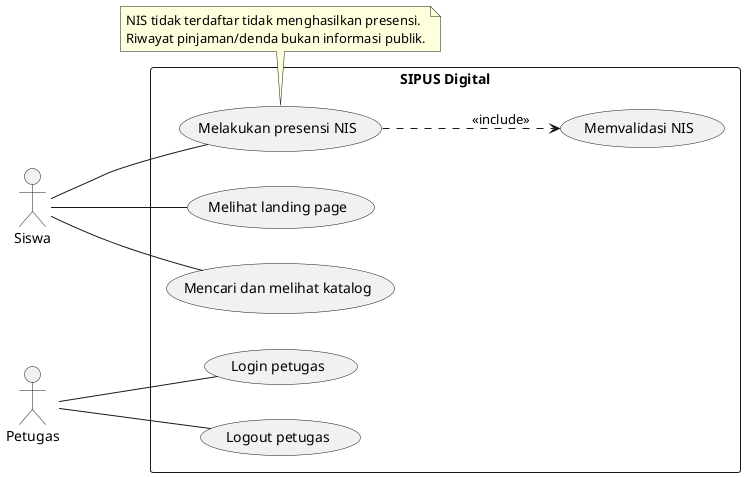

### 3.2 Operasional dan pengingat

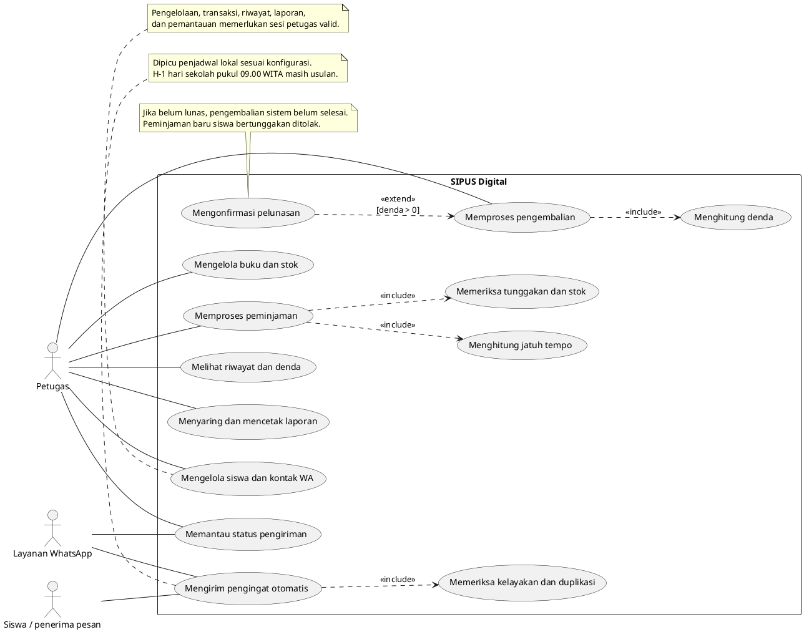

### 3.3 Ringkasan skenario

| Use case | Pemicu/prasyarat | Hasil berhasil | Alternatif utama |
|---|---|---|---|
| Presensi | Siswa memasukkan NIS | Tanggal/jam kunjungan tercatat | NIS tidak dikenal ditolak |
| Peminjaman | Sesi petugas valid; siswa dan buku dipilih | Pinjaman tersimpan, jatuh tempo terbentuk, stok tersedia berkurang | Tunggakan, stok kurang, pembatalan, konflik penyimpanan |
| Pengembalian | Sesi petugas valid; pinjaman aktif dipilih | Denda lunas bila ada; pengembalian dan stok tersimpan | Belum lunas tetap belum dikembalikan; hilang/rusak menunggu aturan |
| Pengingat | Penjadwal aktif, pinjaman memenuhi jadwal | Pesan dikirim dan hasil dicatat sesuai bukti | Tidak layak, duplikat, layanan gagal, hasil belum diketahui |
| Laporan | Sesi petugas valid; jenis/filter dipilih | Pratinjau dan hasil cetak sesuai filter | Tidak ada data atau petugas tidak mencetak |

## 4. Activity diagram

### 4.1 Presensi siswa

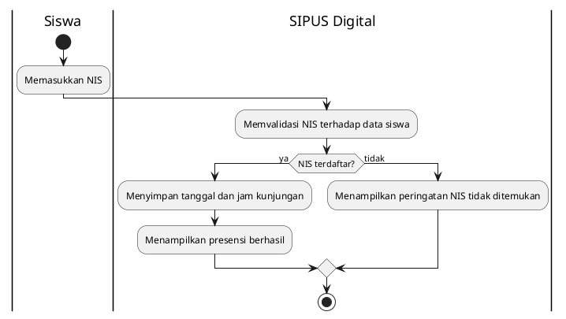

Input ulang berarti memulai percobaan presensi berikutnya. Kebijakan presensi berulang dan terminal yang diawasi petugas belum ditetapkan.

### 4.2 Peminjaman buku

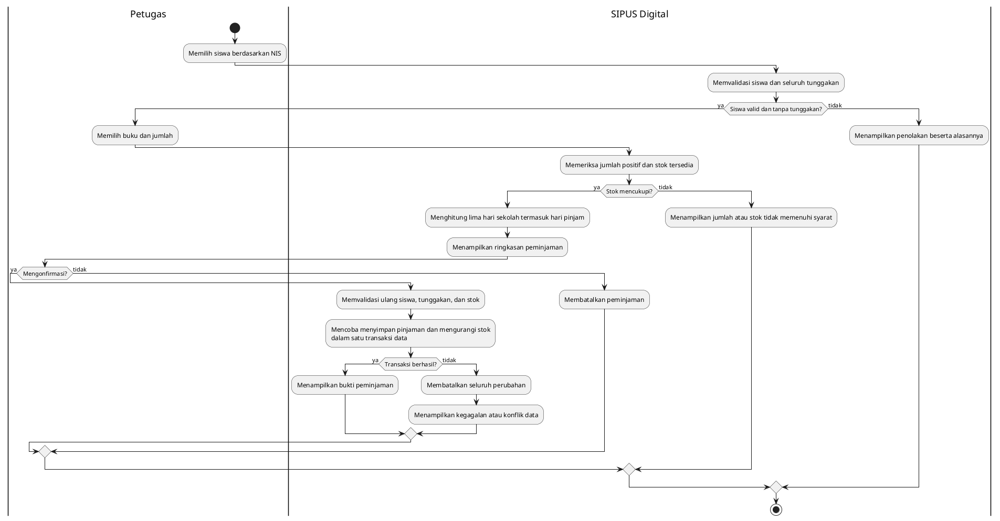

Prasyarat seluruh proses: sesi petugas valid. Pemeriksaan tunggakan mencakup denda yang sudah timbul pada pinjaman aktif, bukan hanya nominal yang pernah disimpan pada tabel pembayaran.

### 4.3 Pengembalian dan denda

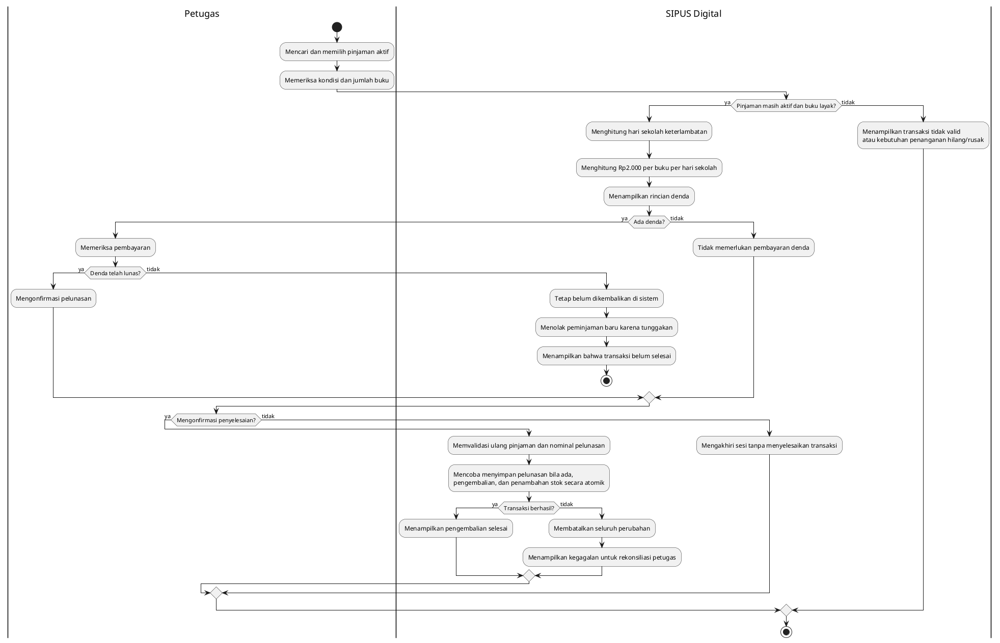

**Batas interpretasi:** buku boleh diterima fisik sebelum lunas, tetapi status pengembalian sistem tetap belum selesai. Pencatatan waktu penerimaan fisik dan kelanjutan denda sesudahnya belum diputuskan. Diagram ini memodelkan pengembalian seluruh buku pada pinjaman yang dipilih; pengembalian sebagian belum ditetapkan. Pembatalan database tidak berarti uang tunai yang telah diserahkan siswa otomatis dikembalikan: petugas perlu memeriksa bukti pembayaran sebelum memproses ulang.

### 4.4 Pengingat WhatsApp otomatis

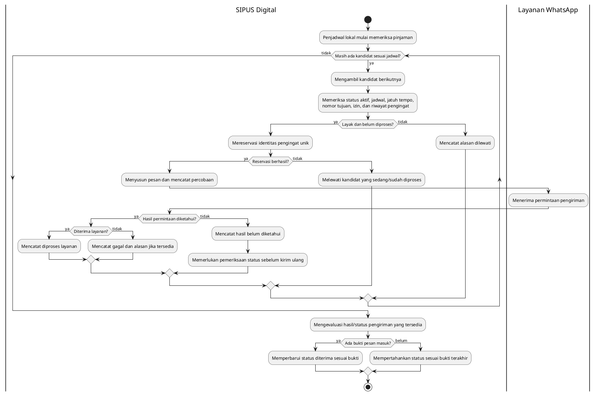

Pembaruan status dapat tiba kemudian; diagram tidak mensyaratkan bukti diterima tersedia pada putaran penjadwal yang sama. Metode pemeriksaan status, polling atau webhook, ditentukan setelah layanan dipilih. Penjadwal tidak berjalan ketika komputer mati/tidur. Usulan penanganan jadwal terlewat: kirim susulan hanya sebelum jatuh tempo bila masih relevan; selain itu catat dilewati. Jangan mengirim ulang otomatis jika hasil permintaan sebelumnya belum diketahui.

### 4.5 Laporan

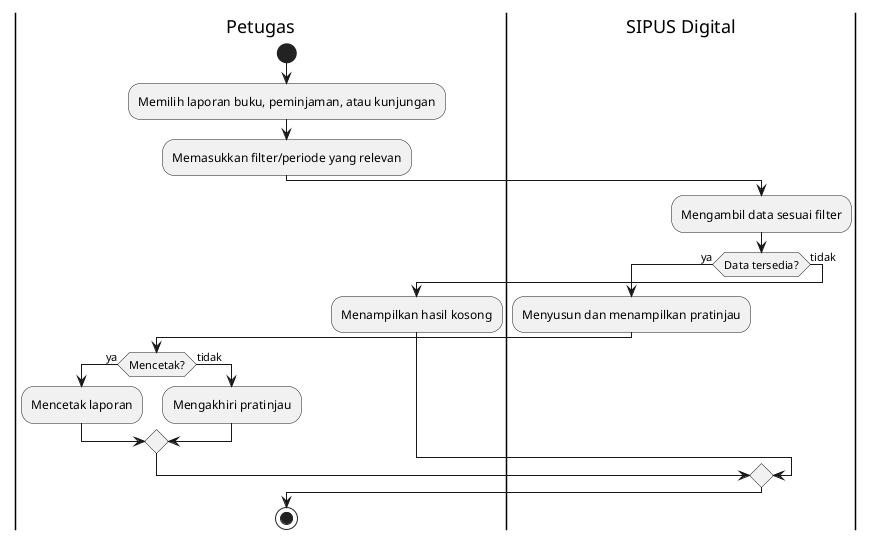

## 5. Sequence diagram

### 5.1 Presensi

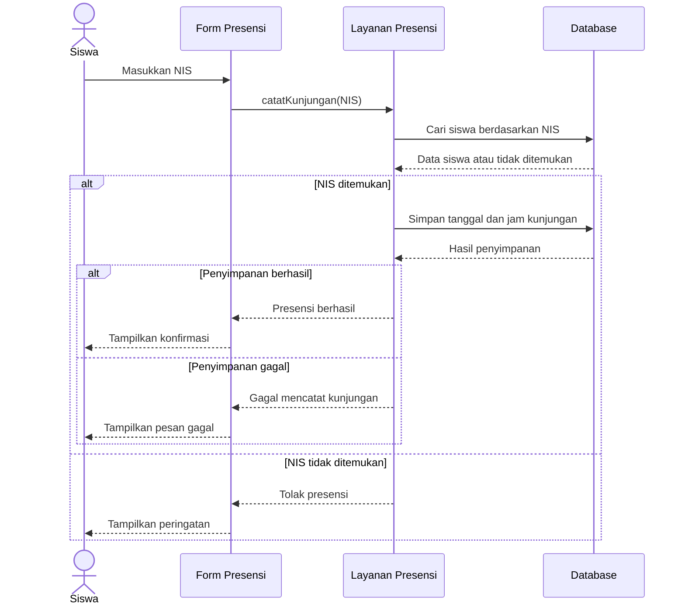

### 5.2 Peminjaman

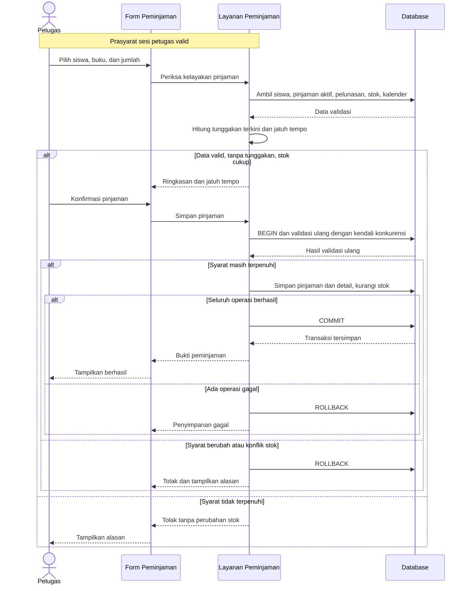

Peminjaman yang sudah sah tidak dibatalkan hanya karena pengiriman WhatsApp di kemudian hari gagal. Penjadwal mengambil pinjaman tersimpan secara terpisah.

### 5.3 Pengembalian dan pelunasan

```mermaid
sequenceDiagram
    actor P as Petugas
    participant U as Form Pengembalian
    participant L as Layanan Pengembalian
    participant D as Database
    Note over P,L: Sesi valid; pinjaman aktif; buku layak; pengembalian seluruh buku
    P->>U: Pilih pinjaman dan periksa buku
    U->>L: Hitung pengembalian
    L->>D: Ambil pinjaman, detail, kalender, dan pelunasan
    D-->>L: Data transaksi
    L->>L: Hitung hari sekolah dan denda per buku
    L-->>U: Rincian denda
    alt Ada denda dan belum lunas
        L-->>U: Belum dikembalikan, tidak boleh pinjam baru
        Note over U,D: Tidak menambah stok atau menyelesaikan pinjaman
    else Denda nol atau pelunasan dikonfirmasi
        P->>U: Konfirmasi pelunasan bila ada dan penyelesaian
        U->>L: Selesaikan pengembalian
        L->>D: BEGIN dan validasi ulang transaksi serta nominal
        D-->>L: Hasil validasi ulang
        alt Transaksi masih aktif dan nominal sesuai
            L->>D: Catat pelunasan bila ada, pengembalian, tambah stok
            alt Seluruh operasi berhasil
                L->>D: COMMIT
                D-->>L: Hasil transaksi
                L-->>U: Pengembalian selesai
                U-->>P: Tampilkan bukti
            else Ada operasi gagal
                L->>D: ROLLBACK
                L-->>U: Gagal, periksa pembayaran sebelum mengulang
            end
        else Transaksi tidak valid atau nominal berubah
            L->>D: ROLLBACK
            L-->>U: Tampilkan alasan dan hitung ulang bila diperlukan
        end
    end
```

Pemblokiran pinjaman berlaku selama **masih ada tunggakan siswa**, bukan hanya tunggakan pada pinjaman yang sedang dibuka. Melunasi satu pinjaman tidak otomatis menghapus blokir jika pinjaman lain masih memiliki denda.

### 5.4 Pengingat otomatis dan bukti penerimaan

```mermaid
sequenceDiagram
    participant J as Penjadwal Lokal
    participant L as Layanan Pengingat
    participant D as Database
    participant W as Layanan WhatsApp
    actor S as Siswa atau Penguji
    J->>L: Periksa jadwal pengingat
    L->>D: Ambil pinjaman, kalender, kontak, izin, riwayat
    D-->>L: Kandidat pengingat
    loop Setiap kandidat
        L->>L: Periksa kelayakan dan jatuh tempo
        alt Layak dikirim
            L->>D: Reservasi identitas pengingat unik secara atomik
            D-->>L: Hasil reservasi
            alt Reservasi baru berhasil
                L->>D: Catat percobaan dan nomor tujuan
                L->>W: Kirim pesan dengan identitas yang dilacak
                alt Permintaan diterima layanan
                    W-->>L: ID pesan atau bukti penerimaan layanan
                    L->>D: Catat diproses layanan
                    opt Pesan kemudian berhasil diterima
                        W-->>S: Pesan masuk ke WhatsApp
                        W-->>L: Bukti status jika layanan mendukung
                        L->>D: Perbarui status hanya sesuai bukti sah
                    end
                else Gagal secara pasti
                    W-->>L: Alasan gagal jika tersedia
                    L->>D: Catat gagal
                else Timeout atau hasil tidak diketahui
                    L->>D: Catat hasil belum diketahui
                    Note over L,W: Periksa status dahulu sebelum mencoba kirim ulang
                end
            else Sudah atau sedang diproses
                L->>D: Jangan membuat pengiriman kedua
            end
        else Tidak layak atau kedaluwarsa
            L->>D: Catat dilewati dan alasannya
        end
    end
    Note over J,S: Demo wajib memeriksa pesan di HP penerima; simulasi atau HTTP sukses tidak cukup
```

Layanan WA belum dipilih. Balasan status pada diagram adalah rancangan interaksi, bukan klaim semua penyedia otomatis menyediakan webhook yang dapat langsung diakses dari komputer lokal. Jika status diterima tidak tersedia dari penyedia, aplikasi tidak boleh menampilkan klaim diterima tanpa bukti; demo tetap memeriksa HP penerima.

## 6. Class diagram konseptual

### 6.1 Data siswa, buku, dan peminjaman

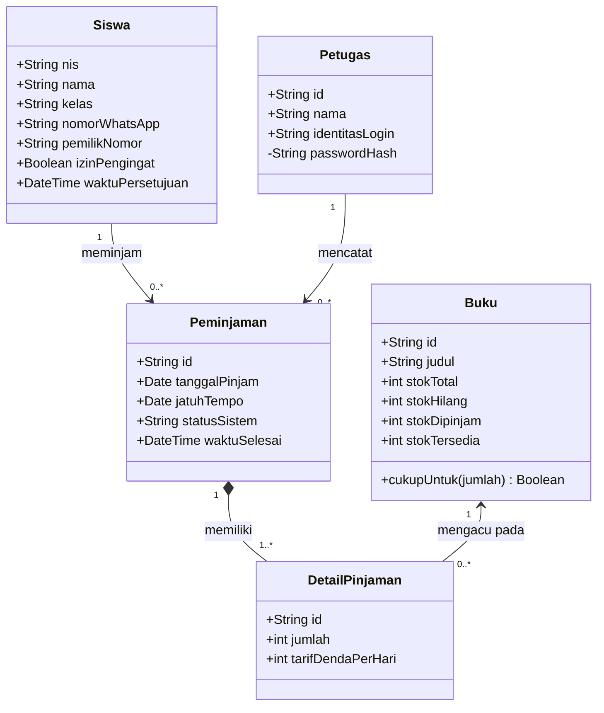

Catatan model:

- NIS unik. Nomor WA tidak unik dan boleh berubah; aturan nomor wajib masih terbuka. Kepemilikan nomor, izin, dan waktu persetujuan adalah usulan atribut untuk kebutuhan pengingat.
- `stokDipinjam` dan `stokTersedia` merupakan nilai logis; boleh dihitung dari transaksi atau disimpan dengan penjagaan konsistensi. Jangan menganggap semua angka tersebut wajib menjadi kolom terpisah.
- Untuk kondisi normal model awal: `stokTersedia = stokTotal - stokHilang - stokDipinjam`. Jika kemudian ditambah stok rusak/dicadangkan, rumus perlu disesuaikan setelah kebijakannya disepakati.
- `stokDipinjam` masih mencakup buku yang sudah diserahkan fisik tetapi belum dikembalikan di sistem karena denda belum lunas, mengikuti aturan PRD saat ini. Ini membuat stok sistem dan keberadaan fisik buku bisa berbeda; jangan menambah stok tanpa transaksi penyelesaian yang sah.
- `tarifDendaPerHari` bernilai Rp2.000 per buku. Snapshot tarif merupakan usulan untuk menjaga riwayat; jumlah denda tidak cukup dihitung hanya saat halaman dibuka petugas.
- Satu peminjaman awal mempunyai satu tanggal pinjam dan jatuh tempo untuk seluruh detail. Pengembalian sebagian, perpanjangan, serta jatuh tempo berbeda di dalam satu transaksi belum ditetapkan.

### 6.2 Kalender, denda, dan pelunasan

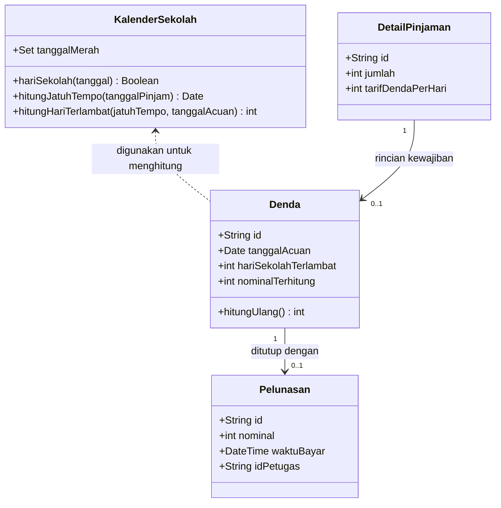

Catatan model:

- `KalenderSekolah` adalah layanan domain dan data kalender; tidak harus satu tabel bernama sama. Hari sekolah: Senin-Jumat kecuali tanggal merah. Hari pinjam adalah hari ke-1.
- Denda detail = jumlah hari sekolah terlambat × Rp2.000 × jumlah buku pada detail yang dikenai denda. Total siswa merupakan penjumlahan kewajiban yang belum lunas.
- Denda yang sudah timbul harus diperhitungkan ketika memeriksa kelayakan pinjaman, meskipun belum memiliki baris `Denda` tersimpan. Keberadaan baris tidak boleh menjadi satu-satunya dasar blokir.
- Model `0..1 Pelunasan` menggambarkan pelunasan penuh, **bukan cicilan**. Struktur penerimaan kas dan bukti pembayaran akhir diputuskan pada database; jangan menerapkan pembayaran sebagian dari diagram ini.
- Jika tidak terlambat, nominal nol dan tidak wajib membuat entitas denda/pelunasan.
- Tanggal acuan berhentinya denda saat buku diterima fisik tetapi belum lunas masih terbuka. Jangan mengunci pilihan tanggal lunas atau tanggal penerimaan tanpa keputusan.

### 6.3 Pengingat dan percobaan pengiriman

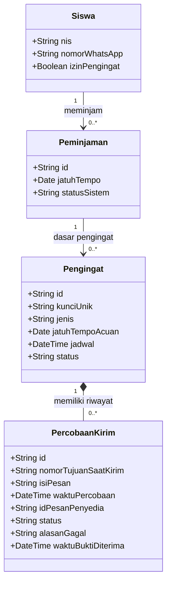

Catatan model:

- Kunci unik pengingat diusulkan dari identitas pinjaman + jenis pengingat + jatuh tempo acuan. Jadwal diperbarui pada pengingat yang sama, bukan membuat pengiriman ganda hanya karena penjadwal dijalankan ulang.
- Pengingat yang diterima atau masih diproses tidak dikirim ulang secara buta. `PercobaanKirim` mengizinkan pencatatan kegagalan dan percobaan ulang yang telah dinyatakan aman, bukan otomatis mengaktifkan retry tanpa batas.
- Nomor tujuan dan isi pesan disimpan sebagai snapshot agar riwayat tetap akurat ketika data kontak berubah.
- Jadwal H-1 pukul 09.00 WITA serta layanan WA masih usulan/keputusan terbuka. Pengingat keterlambatan berulang belum masuk lingkup.
- Kelas berulang di beberapa diagram adalah kelas yang sama, dipisah agar diagram tetap terbaca. Diagram ini bukan tambahan akun siswa atau aplikasi mobile.

## 7. State diagram pengembalian sistem

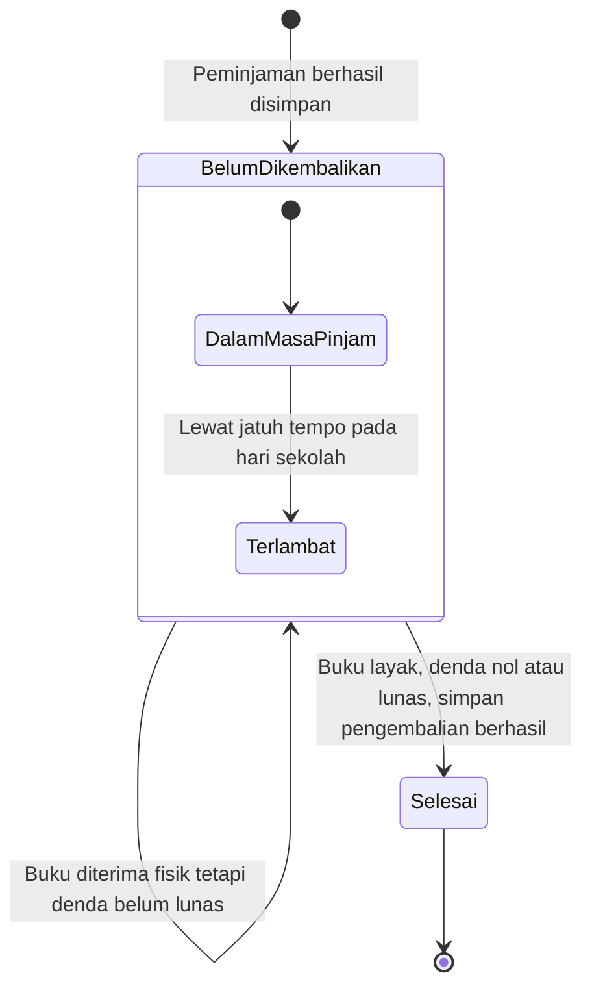

Status pada diagram merupakan **model konseptual**, bukan keputusan enum database final. `DalamMasaPinjam` dan `Terlambat` boleh berupa hasil perhitungan, bukan kolom yang diperbarui tiap hari. Penerimaan fisik sebelum pelunasan tidak memindahkan pinjaman ke `Selesai`. Blokir siswa dihitung dari seluruh tunggakannya; tidak perlu mengubah data siswa menjadi nonaktif hanya karena ada denda.

## 8. Keterlacakan kebutuhan

| PRD | Model UML yang menjelaskan |
|---|---|
| FR-01, FR-02 | Use case layanan publik |
| FR-03 | Activity presensi dan sequence presensi |
| FR-04 | Use case login/logout dan prasyarat sesi petugas |
| FR-05, FR-12 | Use case data siswa/kontak dan class Siswa |
| FR-06 | Use case kelola buku, class Buku, validasi stok pada peminjaman |
| FR-07 | Activity/sequence peminjaman, KalenderSekolah |
| FR-08, FR-09 | Activity/sequence pengembalian, Denda/Pelunasan, state pengembalian |
| FR-10 | Use case riwayat/denda dan relasi siswa-pinjaman-detail |
| FR-11 | Use case laporan dan activity laporan |
| FR-13, FR-14, FR-15 | Activity/sequence pengingat, class Pengingat/PercobaanKirim |

## 9. Catatan untuk tahap berikutnya

1. Putuskan aturan terbuka sebelum menetapkan UML sebagai baseline final, terutama denda setelah penerimaan fisik dan kebijakan nomor WA.
2. Cocokkan layout Antigravity/Figcraft dengan alur utama serta keadaan gagal, stok kurang, tunggakan, dan status kirim yang belum diketahui.
3. Turunkan class konseptual menjadi database setelah kebijakan disepakati; tentukan atribut turunan, kendala unik, transaksi stok, serta pencatatan pembayaran.
4. Tetapkan framework, sesi petugas, penjadwal lokal, dan integrasi WA di architecture. Uji pesan masuk nyata lebih awal.
5. Flowchart dengan simbol input/output tetap berada pada PRD/proposal; jangan menggantikan activity UML dengan flowchart tanpa penjelasan notasi.
